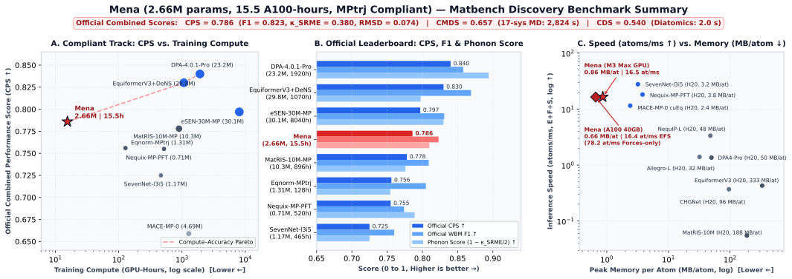

# Mena

**Mena** is a 2.66M-parameter machine learning interatomic potential with a smooth 6.0 Å radial cutoff (tapering neighbor interactions between 5.0 Å and 6.0 Å), trained on MPtrj for 15.5 hours on a single NVIDIA A100-SXM4-40GB GPU (`Muon + AdamW`, 37 epochs) and evaluated locally on an Apple M3 Max (36GB).

## Benchmark Summary (Matbench Discovery — Official Leaderboard Set)

| Task / Metric | Official Result | Notes |
| --- | ---: | --- |
| **Combined Performance Score (`CPS` ↑)** | **0.7859** | Official leaderboard formula (`fillna=1.0` RMSD) |
| **Discovery `F1` ↑** | **0.8232** | Official WBM leaderboard set (`215,488` unique prototypes) |
| **Discovery `DAF` ↑** | **5.1904** | Discovery Acceleration Factor |
| **Precision / Recall ↑** | **0.7935 / 0.8552** | `TP = 28,173`, `FP = 7,333`, `TN = 175,213`, `FN = 4,769` |
| **Accuracy ↑** | **0.9438** | Overall stability classification accuracy |
| **Formation Energy `MAE` / `RMSE` ↓** | **0.0339 / 0.0761 eV/atom** | Hull distance `R² = 0.8290` |
| **Geometry `RMSD` ↓** | **0.0744** (`0.0172` matched) | `StructureMatcher(stol=1.0)` (`0.0059` median, `91.1%` spacegroup match) |
| **Phonons `κ_SRME` ↓** | **0.3803** | 103 PhononDB crystals (`κ_SRE = 0.2114`, `κ_SRD = -0.1162`, `0%` imaginary/failed) |
| **Diatomics `CDS` ↑** | **0.5402** | Homo-nuclear diatomics (`2.0 s` runtime, `73/73` valid elements) |
| **Peak Memory per Atom ↓** | **0.66 MB/atom** (A100) / **0.86 MB/atom** (M3 Max) | Diamond (`r_cut = 6.0 Å`, 158 neighbors/atom, E+F+S) |
| **Inference Speed ↑** | **16.5 atoms/ms** (E+F+S) / **78.2 atoms/ms** (Forces) | Compiled (`torch.compile`), linear scaling to 49k atoms on 40GB A100 |

## Contact

Francesco Viola (`francesco.viola001@studenti.uniparthenope.it`)
